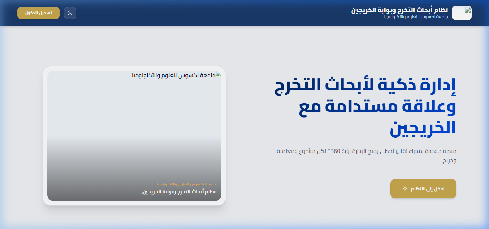
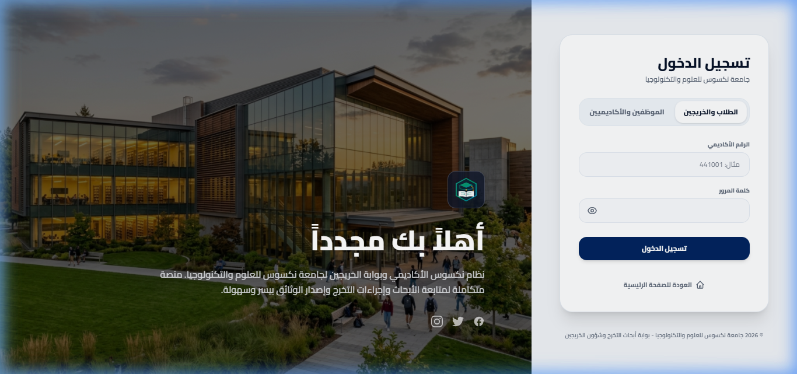
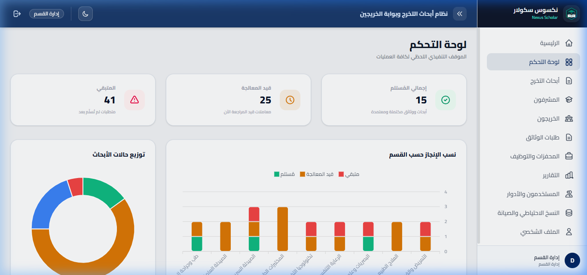
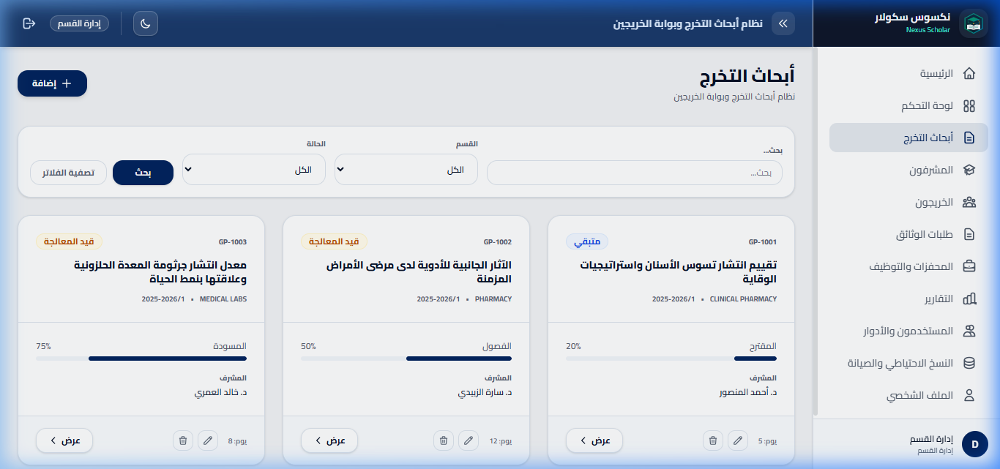
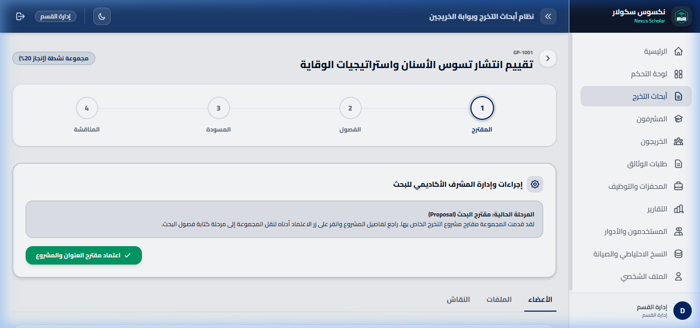
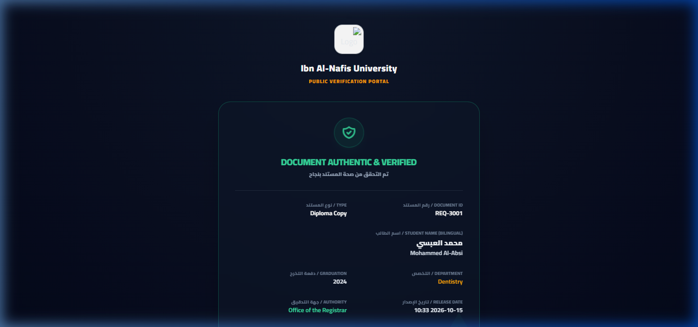
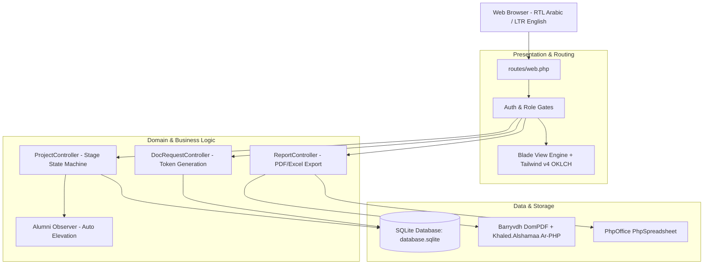

# Nexus Scholar — Academic Research Lifecycle & Alumni Portal

> **A high-performance academic management platform unifying graduation thesis milestones, scientific integrity checks, and zero-trust alumni credential verification.**

[](https://laravel.com)
[](https://php.net)
[](https://tailwindcss.com)
[](https://vitejs.dev)
[](https://sqlite.org)

---

## 1. Problem Statement & Executive Summary
Universities and academic departments struggle with fragmented, manual processes when coordinating final-year graduation research. Mentors review drafts across uncoordinated messaging channels, scientific integrity scoring (plagiarism index) is checked inconsistently, and post-graduation certificate verification requires tedious bureaucratic correspondence.

**Nexus Scholar** addresses this operational friction with an end-to-end, multi-role academic portal that:
- Coordinates graduation project milestones through an enforced state machine (`Proposal` $\rightarrow$ `Chapters` $\rightarrow$ `Draft` $\rightarrow$ `Defense`).
- Enforces automated scientific integrity rules (blocking defense progression if plagiarism index $> 20\%$).
- Triggers automatic student-to-alumni role elevation upon thesis approval.
- Exposes a zero-trust public credential verification gateway (`/verify-document/{code}`) for immediate diploma authentication by employers.
- Delivers an executive 360° reporting engine capable of generating Arabic RTL PDF documents and multi-sheet Excel workbooks.

---

## 2. Visual Walkthrough & Verified Screenshots

### 2.1 Public Landing & Authentication Gateway
The public portal provides dual-language support (Arabic RTL / English LTR), dark and light theme toggling, and dedicated authentication gateways for students and academic staff.

| Public Landing Gateway | Modern Multi-Persona Login |
| :---: | :---: |
|  |  |

### 2.2 Department Executive Oversight & Cohort Catalog
The department dashboard aggregates real-time metrics across academic cohorts, including completion percentages by department and research status distributions.

| 360° Executive Dashboard | Cohort Management Catalog |
| :---: | :---: |
|  |  |

### 2.3 Academic Stepper Workspace & Public Credential Verification
Every graduation cohort workspace enforces a 4-phase milestone stepper with inline feedback threads. Graduated students receive official credentials verifiable via a public token route.

| 4-Phase Stepper Workspace | Zero-Trust Credential Verification |
| :---: | :---: |
|  |  |

---

## 3. System Architecture & Core Design Decisions



### Key Engineering Decisions:
1. **Model Observer Lifecycle Elevation**: Rather than requiring manual administrative intervention, the graduation process is event-driven: when a supervisor records a `passed` grade during thesis defense, the system triggers a database transaction that elevates linked students to `alumnus` and bootstraps their `AlumniProfile`.
2. **Plagiarism Index Policy Barrier**: Model policies strictly enforce that a project cannot advance from `Draft` to `Defense` if `plagiarism_percent` exceeds $20\%$.
3. **Arabic RTL Text Shaping in PDFs**: Standard DomPDF engines break Arabic bidirectional text. The reporting service integrates `khaled.alshamaa/ar-php` glyph shaping (`ar_fix()`) to render flawless Arabic RTL documents.
4. **Hybrid OKLCH Design System**: The UI utilizes Tailwind CSS v4 OKLCH color palettes, ensuring vibrant, accessible contrast across dark (`#121212`) and light modes.

---

## 4. Technology Stack

| Layer | Technologies Used | Rationale |
| :--- | :--- | :--- |
| **Backend** | PHP 8.3+ / 8.5, Laravel 11.x | Robust MVC architecture, Eloquent ORM, strict routing, and granular RBAC gates. |
| **Database** | SQLite 3 | Zero-configuration local demonstration, cross-compatible with MySQL / PostgreSQL. |
| **Frontend** | Blade, Tailwind CSS v4, Vanilla JS | Lightweight, ultra-responsive UI without heavy SPA runtime overhead. |
| **Bundling** | Vite 8.0, `@tailwindcss/vite` | Rapid HMR development and optimized production asset minification. |
| **Document Processing** | `barryvdh/laravel-dompdf`, `phpoffice/phpspreadsheet`, `khaled.alshamaa/ar-php` | High-fidelity Arabic PDF and Excel reporting engines. |
| **Testing** | PHPUnit 12.x / Feature Test Suite | In-memory SQLite (`:memory:`) feature testing ensuring zero regression. |

---

## 5. Quickstart & Local Setup

### Prerequisites
- **PHP**: `^8.3` or `^8.5` with `sqlite3`, `mbstring`, `openssl`, `gd` extensions.
- **Composer**: `^2.x`
- **Node.js**: `^20.x` or `^22.x` & `npm`

### Setup Instructions

```powershell
# 1. Clone repository and navigate to folder
git clone https://github.com/hussainalkhamri/nexus-scholar.git
cd nexus-scholar

# 2. Install PHP and Node dependencies
composer install
npm install

# 3. Configure environment
copy .env.example .env
php artisan key:generate

# 4. Initialize database and seed synthetic demo data
New-Item -ItemType File -Force -Path "database/database.sqlite"
php artisan migrate:fresh --seed

# 5. Compile frontend assets
npm run build

# 6. Launch local server
php artisan serve
```

Access the portal at `http://127.0.0.1:8000`.

---

## 6. Seeded Demo Accounts (Synthetic Personas)
All accounts use the standard demo password: **`password`**.

| Role Key | Name in Arabic / English | Seeded Email | Password |
| :--- | :--- | :--- | :--- |
| `admin` | إدارة القسم / Department Admin | `admin@nexus-scholar.edu` | `password` |
| `supervisor` | د. أحمد المنصور / Dr. Ahmad Al-Mansour | `supervisor@nexus-scholar.edu` | `password` |
| `student` | علي السقاف / Ali Al-Saqqaf | `student@nexus-scholar.edu` | `password` |
| `alumnus` | محمد العبسي / Mohammed Al-Absi | `alumni@nexus-scholar.edu` | `password` |
| `super_admin` | مدير النظام العام / Super Administrator | `superadmin@nexus-scholar.edu` | `password` |

---

## 7. Automated Test Suite & Verification

Run the automated test suite with PHPUnit:

```powershell
php artisan test
```

*Note: Tests execute against an in-memory database (`:memory:`) without modifying or altering the local `database.sqlite` file.*

---

## 8. Security & Privacy Notes
- **Company-Neutral**: This demonstration repository has been sanitized to preserve engineering architecture while removing all client trademarks, client identities, and private operational records.
- **Pure Synthetic Data**: All accounts, thesis titles, and certificates represent fictional mock records.
- **Hardened Routes**: Internal deployment scripts and webhooks have been excised to prevent unauthorized execution.

---

## 9. Author & Contact
- **Author**: Hussain Al-Khamri (Software Engineer & Architect)
- **GitHub**: [github.com/hussainalkhamri](https://github.com/hussainalkhamri/)
- **Email**: [saleh7ussain@gmail.com](mailto:saleh7ussain@gmail.com)
