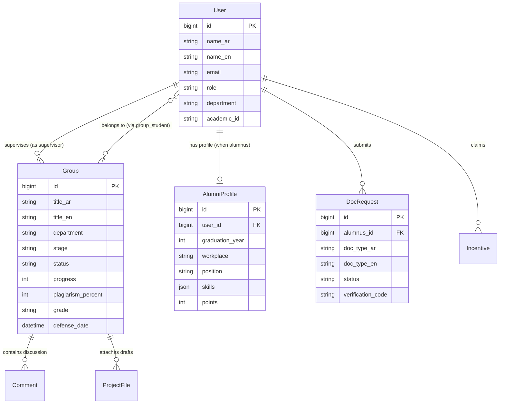
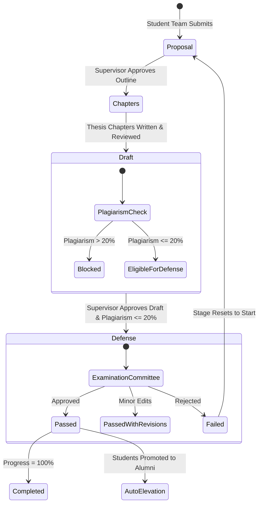

# System Architecture & Technical Specifications

## 1. Architectural Overview
**Nexus Scholar** is engineered around domain-driven patterns within the Laravel MVC framework. It manages complex academic transitions, multi-tenant department categorization, and lifecycle gating.

---

## 2. Core Domain Models & Relationships

---

## 3. Milestone State Machine & Scientific Integrity Enforcer

---

## 4. Reporting & PDF Engine Design
The reporting subsystem generates formal academic transcripts and executive summaries in Arabic and English:
- **Challenge**: Standard PDF renderers do not support complex bidirectional text or Arabic letter connections (e.g., disconnected isolated glyphs).
- **Solution**: The `app/Helpers/helpers.php` layer employs `Khaled.Alshamaa/Ar-Php` glyph shaping algorithms via `ar_fix()`, transforming characters into their contextual medial/final/initial ligatures prior to DOMPDF HTML compilation.
- **Result**: Native PDF outputs formatted with official university crests, QR authentication tokens, and bilingual student details.
